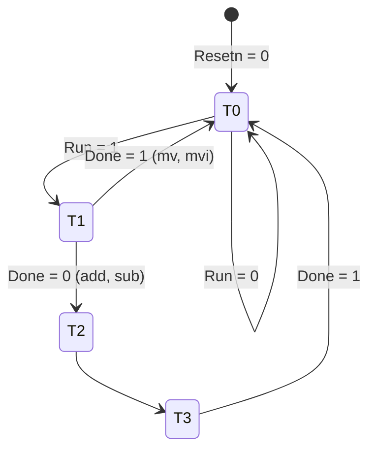
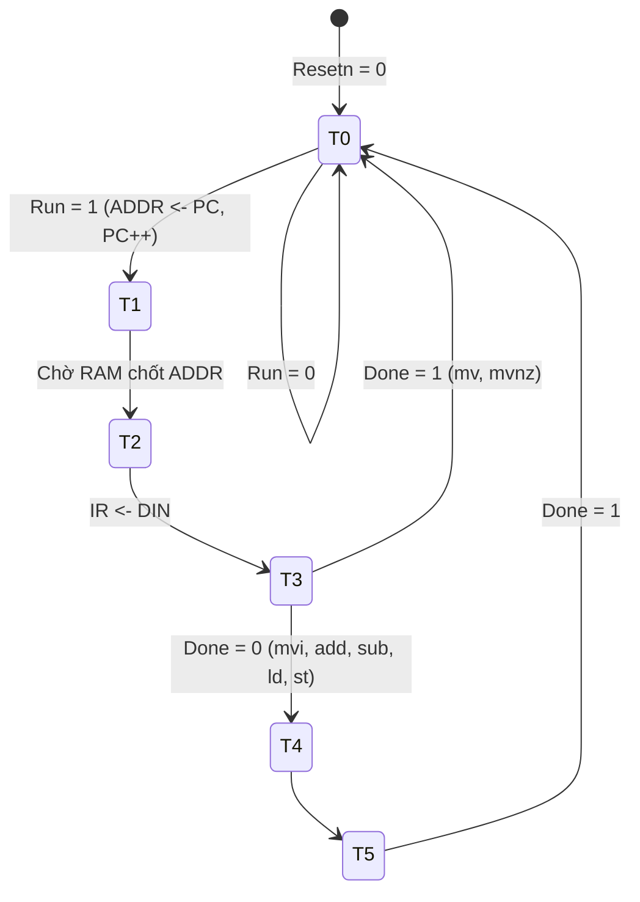

# BÁO CÁO BÀI TẬP LỚN — HỌC PHẦN MỞ RỘNG KỸ THUẬT SỐ (EE1009)
> *Ghi chú soạn thảo: Tài liệu này là khung nội dung hoàn chỉnh (căn chỉnh cho khoảng 12–14 trang khi xuất PDF, đảm bảo đúng yêu cầu **tối đa 15 trang**). Bạn chỉ cần đưa vào Word / Google Docs / LaTeX và chèn các ảnh chụp RTL Viewer, Waveform ModelSim, Timing Analyzer theo đúng các ô `[CHÈN ẢNH ...]`.*

---

## TRANG 1: TRANG BÌA
- **Trường:** Đại học Bách Khoa — ĐHQG TP.HCM (HCMUT)
- **Khoa:** Điện – Điện tử (Bộ môn Điện tử)
- **Môn học:** Học phần mở rộng — Kỹ Thuật Số (EE1009)
- **Đề tài:** Thiết kế Bộ xử lý đơn giản (Lab 4) và Bộ xử lý cải tiến tích hợp bộ nhớ RAM & ngoại vi trên FPGA DE10-Standard (Lab 5)
- **Giảng viên hướng dẫn:** Cô Phan Võ Kim Anh
- **Sinh viên thực hiện:** `[Họ tên — MSSV]`
- **Học kỳ:** HK261 — Năm học 2026–2027

---

## TRANG 2–6: PHẦN 1 — LAB 4: BỘ XỬ LÝ ĐƠN GIẢN (A SIMPLE PROCESSOR)

### 1.1. Tổng quan kiến trúc & Tập lệnh (Lab 4 — Experiment 1)
Bộ xử lý 9-bit `proc` được thiết kế theo mô hình RTL gồm hai phần: **Datapath** và **Control Unit (FSM)**.

- **Datapath (`proc.sv`):**
  - **8 thanh ghi đa dụng 9-bit** (`R0`–`R7`, module `regn #(.N(9))`), được chọn nạp bởi tín hiệu `Rin[7:0]` và chọn xuất ra bus bởi `Rout[7:0]` thông qua hai bộ giải mã `dec3to8` (`decX`, `decY`).
  - **Khối số học (`addsub #(.N(9))`)** cùng thanh ghi tạm `A` (`Ain`) và thanh ghi kết quả `G` (`Gin`, `Gout`): thực hiện `A + Bus` khi `AddSub = 0` và `A - Bus` khi `AddSub = 1` (số có dấu bù 2, 9-bit).
  - **Thanh ghi lệnh `IR`** (9-bit, `IRin`) nhận trực tiếp mã lệnh từ `DIN[8:0]` với định dạng `III_XXX_YYY`: `IR[8:6]` là mã lệnh `I`, `IR[5:3]` là thanh ghi đích `Rx`, `IR[2:0]` là thanh ghi nguồn `Ry`.
  - **Bus 9-bit (`BusWires`)**: xây dựng bằng bộ dồn kênh 10-sang-1 chọn một trong `{R0..R7, G, DIN}` dựa trên vector điều khiển one-hot `{Rout[7:0], Gout, DINout}`.

| Opcode (`IR[8:6]`) | Lệnh | Hoạt động | Số chu kỳ |
| :---: | :--- | :--- | :---: |
| `000` | `mv Rx, Ry` | `Rx <- [Ry]` | 2 (`T0`–`T1`) |
| `001` | `mvi Rx, #D` | `Rx <- DIN` (hằng số ở chu kỳ kế tiếp) | 2 (`T0`–`T1`) |
| `010` | `add Rx, Ry` | `Rx <- [Rx] + [Ry]` | 4 (`T0`–`T3`) |
| `011` | `sub Rx, Ry` | `Rx <- [Rx] - [Ry]` | 4 (`T0`–`T3`) |

> `[CHÈN ẢNH 1: Sơ đồ khối kiến trúc Simple Processor (Figure 1 Lab 4) + RTL Viewer của lab4_exp1_proc]`

### 1.2. Thiết kế FSM điều khiển (Control Unit — `T0`..`T3`)

| Trạng thái | Điều kiện / Lệnh | Tín hiệu điều khiển tích cực (`= 1`) | Trạng thái kế tiếp |
| :---: | :--- | :--- | :---: |
| **`T0`** | Mọi lệnh | `IRin` | `Run ? T1 : T0` |
| **`T1`** | `mv` (`000`) | `Rout = Yreg`, `Rin = Xreg`, `Done` | `T0` |
| **`T1`** | `mvi` (`001`) | `DINout`, `Rin = Xreg`, `Done` | `T0` |
| **`T1`** | `add` (`010`), `sub` (`011`) | `Rout = Xreg`, `Ain` | `T2` |
| **`T2`** | `add` (`010`) | `Rout = Yreg`, `Gin` (`AddSub = 0`) | `T3` |
| **`T2`** | `sub` (`011`) | `Rout = Yreg`, `AddSub`, `Gin` | `T3` |
| **`T3`** | `add` (`010`), `sub` (`011`) | `Gout`, `Rin = Xreg`, `Done` | `T0` |

### 1.3. Kết quả mô phỏng Lab 4 — Experiment 1
Mô phỏng trên ModelSim (`tb_proc.sv`) thực thi chuỗi lệnh kiểm chứng `mvi R0,#5` → `mv R1,R0` → `add R0,R1` (`R0 = 0x00A`) → `sub R0,R0` (`R0 = 0x000`) khớp hoàn toàn với Figure 2 trong tài liệu Lab 4, đồng thời kiểm chứng thêm phép cộng số âm 9-bit bù 2 (`mvi R2,#-6` = `0x1FA`; `add R1,R2` → `5 + (-6) = -1 = 0x1FF`). Kết quả biên dịch Quartus 18.1: **0 errors, 0 warnings** (209 logic cells).

> `[CHÈN ẢNH 2: Waveform ModelSim của lab4_exp1_proc (DIN, IR ở hệ Octal; R0, R1, R2, A, G, BusWires ở hệ Hex)]`

---

### 1.4. Hệ thống Bộ xử lý kết nối ROM 32x9 và Bộ đếm 5-bit (Lab 4 — Experiment 2)
Mở rộng hệ thống bằng cách kết nối `proc` (chạy xung `PClock`) với:
- **Bộ đếm 5-bit `counter5`**: chạy xung `MClock`, reset bất đồng bộ mức thấp `Resetn`, sinh địa chỉ tuần tự `0..31`.
- **Bộ nhớ chỉ đọc `my_rom` (`32 x 9 ROM`)**: theo đính chính của giảng viên (chuyển từ RAM sang ROM), có thanh ghi chốt địa chỉ 5-bit ở ngõ vào (`posedge MClock`) và ngõ ra tổ hợp 9-bit `DATAOUT` cấp trực tiếp vào `DIN` của bộ xử lý.

**Bảng chuyển đổi mã lệnh nạp vào `my_ROM.mif` (Pre-Lab 4 — Exercise 1):**

| Địa chỉ ROM | Lệnh Assembly | Ý nghĩa | Mã nhị phân (`III_XXX_YYY`) | Octal | Hex |
| :---: | :--- | :--- | :---: | :---: | :---: |
| `0` | `mv R1, R4` | `R1 <- [R4]` | `000_001_100` | `014` | `00C` |
| `1` | `mv R3, R2` | `R3 <- [R2]` | `000_011_010` | `032` | `01A` |
| `2` | `mvi R2, #5` | `R2 <- +5` (word lệnh) | `001_010_000` | `120` | `050` |
| `3` | `#5` | Hằng số `+5` (9-bit) | `000_000_101` | `005` | `005` |
| `4` | `mvi R4, #-6` | `R4 <- -6` (word lệnh) | `001_100_000` | `140` | `060` |
| `5` | `#-6` | Hằng số `-6` (bù 2 9-bit) | `111_111_010` | `772` | `1FA` |
| `6` | `add R3, R7` | `R3 <- [R3] + [R7]` | `010_011_111` | `237` | `09F` |
| `7` | `add R2, R0` | `R2 <- [R2] + [R0]` | `010_010_000` | `220` | `090` |
| `8` | `sub R5, R6` | `R5 <- [R5] - [R6]` | `011_101_110` | `356` | `0EE` |

> `[CHÈN ẢNH 3: RTL Viewer của lab4_exp2_top (Counter5 -> MyROM -> proc)]`  
> `[CHÈN ẢNH 4: Waveform ModelSim của lab4_exp2_top chứng minh nạp và thực thi đúng toàn bộ 7 lệnh từ my_ROM.mif]`

---

## TRANG 7–13: PHẦN 2 — LAB 5: BỘ XỬ LÝ CẢI TIẾN & TRIỂN KHAI FPGA DE10-STANDARD

### 2.1. Các cải tiến kiến trúc của Enhanced Processor (`proc_enhanced`)
So với Lab 4, bộ xử lý cải tiến loại bỏ bộ đếm địa chỉ rời bên ngoài và hỗ trợ truy xuất RAM/ngoại vi:
1. **Thanh ghi `R7` trở thành Program Counter (`pc_counter`)**: bộ đếm 9-bit có `Resetn` (xóa về `0`), ngõ tăng `incr_pc` (`E`) tự động cộng 1 sau mỗi lần nạp lệnh/immediate, và ngõ nạp song song `R7in` (`L`) cho phép nhảy đến bất kỳ địa chỉ nào qua `mv R7, Ry`, `mvi R7, #addr` hoặc `mvnz R7, Ry`.
2. **Bổ sung 3 thanh ghi giao tiếp bộ nhớ/ngoại vi**: `ADDR[8:0]` (`ADDRin`), `DOUT[8:0]` (`DOUTin`) và Flip-Flop 1-bit `W` (nhận `W_D` từ FSM, reset về `0` khi `Resetn = 0`).
3. **Bổ sung 3 lệnh mới** (tổng cộng 7 lệnh):
   - `100` (`ld Rx, [Ry]`): `Rx <- Memory[Ry]`
   - `101` (`st Rx, [Ry]`): `Memory/Peripheral[Ry] <- Rx`
   - `110` (`mvnz Rx, Ry`): nếu thanh ghi `G != 0` (`|G == 1`) thì `Rx <- Ry`.

### 2.2. Thiết kế FSM 6 trạng thái (`T0`..`T5`) & Đồng bộ Timing với RAM
Vì bộ nhớ `RAM: 1-PORT` của Quartus có **ngõ vào được chốt qua thanh ghi** (`addr`, `data`, `wr_en`) và **ngõ ra tổ hợp** (`q` không registered), từ thời điểm CPU chốt địa chỉ vào `ADDR` đến khi dữ liệu xuất hiện hợp lệ trên `DIN` cần **1 chu kỳ chờ** để thanh ghi địa chỉ nội bộ của RAM chốt `ADDR`. Do đó FSM được thiết kế gồm **6 trạng thái (`T0`–`T5`)**:

| Trạng thái | Lệnh | Tín hiệu điều khiển tích cực (`= 1`) | Ghi chú Timing |
| :---: | :--- | :--- | :--- |
| **`T0`** | Mọi lệnh (`Run=1`) | `R7out`, `ADDRin`, `incr_pc` | `ADDR <= PC`; `PC <= PC + 1` (khi `Run=0`, giữ nguyên PC) |
| **`T1`** | Mọi lệnh | *(chờ)* | RAM chốt `ADDR` ở cạnh lên kết thúc `T1` → `DIN` có mã lệnh |
| **`T2`** | Mọi lệnh | `IRin` | Chốt mã lệnh từ `DIN` vào `IR` |
| **`T3`** | `mv` (`000`) | `Rout = Yreg`, `Rin = Xreg`, `Done` | Hoàn tất trong 4 chu kỳ (`T0`–`T3`) |
| **`T3`** | `mvnz` (`110`) | Nếu `G != 0`: `Rout = Yreg`, `Rin = Xreg`; luôn bật `Done` | Kiểm tra cờ `|G` từ phép toán ALU gần nhất |
| **`T3`** | `mvi` (`001`) | `R7out`, `ADDRin`, `incr_pc` | Đưa địa chỉ immediate ra `ADDR`, tăng PC |
| **`T3`** | `add`/`sub` (`010`/`011`) | `Rout = Xreg`, `Ain` | Nạp toán hạng thứ nhất vào `A` |
| **`T3`** | `ld`/`st` (`100`/`101`) | `Rout = Yreg`, `ADDRin` | Đưa địa chỉ đích `[Ry]` ra `ADDR` |
| **`T4`** | `mvi`, `ld` | *(chờ)* | RAM chốt `ADDR` dữ liệu/immediate → `DIN` hợp lệ |
| **`T4`** | `add` / `sub` | `Rout = Yreg`, `Gin` (`AddSub = 0` với `add`, `1` với `sub`) | Tính `A ± Ry` lưu vào `G` |
| **`T4`** | `st` (`101`) | `Rout = Xreg`, `DOUTin`, `W_D` | Chốt `DOUT <= Rx`, `W <= 1` cho chu kỳ `T5` |
| **`T5`** | `mvi`, `ld` | `DINout`, `Rin = Xreg`, `Done` | Nạp dữ liệu từ `DIN` vào `Rx` |
| **`T5`** | `add`, `sub` | `Gout`, `Rin = Xreg`, `Done` | Ghi kết quả từ `G` vào `Rx` |
| **`T5`** | `st` (`101`) | `Done` (`W_D = 0`) | Trong suốt `T5`, `W = 1` để RAM/LED chốt ghi tại cạnh lên kết thúc `T5`, đồng thời xóa `W <= 0` |

> `[CHÈN ẢNH 5: RTL Viewer của proc_enhanced (Project 1 Lab 5)]`  
> `[CHÈN ẢNH 6: Waveform ModelSim của tb_proc_enhanced chứng minh đủ 7 lệnh mv, mvi, add, sub, ld, st, mvnz]`

---

### 2.3. Kết nối Hệ thống Hoàn chỉnh trên DE10-Standard (`lab5_system_top`)
Theo Figure 2 (Lab 5) và giải thích từ giảng viên về không gian địa chỉ 9-bit (`ADDR[8:0]`):
- **Vùng RAM (`A8A7 = 00`):** `mem_wr_en = ~(ADDR[8] | ADDR[7]) & W`. RAM 1-PORT kích thước `128 words x 9-bit` nhận 7 bit địa chỉ thấp `ADDR[6:0]`, dữ liệu ghi `DOUT[8:0]`, xuất `q[8:0]` (không registered) về `DIN[8:0]`. Tổng hợp trên Cyclone V sử dụng **1 khối M10K (`altsyncram`, 1,152 bits)** khởi tạo từ `program_fpga.mif` (chương trình đếm nhị phân có 2 vòng trễ lồng nhau `511 x 511`, tốc độ đếm ~19 Hz ở 50 MHz).
- **Vùng LEDs (`A8A7 = 01`):** `led_en = (~ADDR[8] & ADDR[7]) & W`. Thanh ghi 9-bit `u_leds_reg` chốt `DOUT` khi `led_en = 1`, nối trực tiếp ra `LEDR[8:0]`.
- **Bộ đồng bộ 2 Flip-Flop (`run_sync`):** Tín hiệu `SW[9]` (`Run`) là đầu vào bất đồng bộ nên đi qua chuỗi 2 D-FF đồng bộ theo `CLOCK_50` để triệt tiêu trạng thái siêu ổn định (metastability).

**Bảng gán chân trên kit Terasic DE10-Standard (Cyclone V `5CSXFC6D6F31C6`, chuẩn `3.3-V LVTTL`):**

| Tín hiệu | Chức năng | Chân FPGA |
| :--- | :--- | :--- |
| `CLOCK_50` | Xung nhịp hệ thống 50 MHz | `PIN_AF14` |
| `KEY[0]` | `Resetn` (tích cực mức thấp) | `PIN_AJ4` |
| `SW[9]` | `Run` (qua mạch đồng bộ 2-FF) | `PIN_AA30` |
| `LEDR[8:0]` | Ngõ ra thanh ghi LEDs 9-bit | `AB22, AF24, AE24, AF25, AG25, AD24, AC23, AB23, AA24` |

> `[CHÈN ẢNH 7: RTL Viewer của lab5_system_top (thấy rõ u_run_sync, u_proc, cổng giải mã địa chỉ, u_ram, u_leds_reg)]`  
> `[CHÈN ẢNH 8: Waveform ModelSim toàn hệ thống lab5_system_top (dùng program_sim.mem thấy LEDR đếm 0->1->2->3->4, pause/resume với SW[9] và reset với KEY[0])]`

---

### 2.4. Kết quả Tổng hợp, Phân tích Timing 50 MHz & Thực nghiệm trên Kit DE10-Standard

**Tài nguyên phần cứng sử dụng (Quartus Prime 18.1 — Fitter Summary):**
- Thiết bị: Intel Cyclone V `5CSXFC6D6F31C6`
- Logic utilization: **105 / 41,910 ALMs (< 1%)**
- Tổng số thanh ghi (Registers): **140**
- Bộ nhớ nhúng (Block Memory): **1,152 bits — 1 / 553 khối M10K (< 1%)** (`altsyncram`, `SINGLE_PORT`, `OUTDATA_REG_A = UNREGISTERED`)
- Tổng số chân I/O: **12 / 499 (2%)**

**Kết quả TimeQuest Timing Analyzer (ràng buộc `CLOCK_50 = 50 MHz`, chu kỳ `20.000 ns`):**

| Mô hình Timing (PVT Corner) | Fmax đạt được | Setup Slack (ns) | Hold Slack (ns) | Min Pulse Width Slack (ns) | Trạng thái |
| :--- | :---: | :---: | :---: | :---: | :---: |
| Slow 1100mV 85°C | **101.81 MHz** | `+10.178` | `+0.206` | `+8.960` | **PASS** |
| Slow 1100mV 0°C | **100.94 MHz** | `+10.093` | `+0.193` | `+8.992` | **PASS** |
| Fast 1100mV 85°C | — | `+14.485` | `+0.134` | `+8.534` | **PASS** |
| Fast 1100mV 0°C | — | `+14.896` | `+0.121` | `+8.484` | **PASS** |

- **Metastability Report:** Phát hiện 1 chuỗi đồng bộ 2 tầng (`u_run_sync`), **Worst-Case MTBF = `1e+09` năm**, đáp ứng an toàn tuyệt đối cho tín hiệu bất đồng bộ `SW[9]`.
- **Kết luận Timing:** Tần số hoạt động tối đa ở điều kiện xấu nhất là **100.94 MHz** (gấp đôi yêu cầu **50 MHz**), toàn bộ các đường tín hiệu đều thỏa Setup/Hold với `TNS = 0.000 ns`, **0 lỗi, 0 cảnh báo Timing**.

> `[CHÈN ẢNH 9: Ảnh chụp TimeQuest Timing Analyzer Summary (Fmax, Setup/Hold Slack, Metastability) trong Quartus 18.1]`  
> `[CHÈN ẢNH 10: Ảnh chụp kit DE10-Standard đang chạy chương trình đếm hiển thị trên LEDR[8:0]]`

---

## TRANG 14: PHẦN 3 — KẾT LUẬN
- Đã thiết kế, mô phỏng chức năng (ModelSim 10.5b — 100% test case đạt), tổng hợp RTL và kiểm tra thời gian (Quartus Prime 18.1 — 0 lỗi) cho trọn bộ **Lab 4** (Exp 1 & Exp 2) và **Lab 5** (Enhanced Processor & hệ thống đầy đủ).
- Hệ thống Lab 5 chạy ổn định ở tần số **50 MHz** trên kit **Terasic DE10-Standard** (`Fmax = 100.94 MHz`), tích hợp RAM 1-PORT trên khối M10K, giải mã địa chỉ tách biệt RAM (`A8A7 = 00`) và LEDs (`A8A7 = 01`), đồng bộ 2-FF cho tín hiệu `Run` (`SW[9]`), và hiển thị chính xác bộ đếm nhị phân trên `LEDR[8:0]`.
